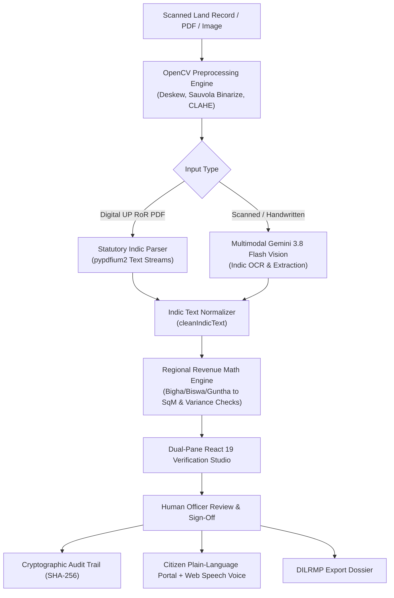

# 🏛️ BhooLekha Studio (भू-लेखा Studio)
### AI-Assisted Indian Land Records Digitization & Verification Workbench

[](https://vitejs.dev/)
[](https://react.dev/)
[](https://www.typescriptlang.org/)
[](https://fastapi.tiangolo.com/)
[](https://opencv.org/)
[](https://aistudio.google.com/)

> **Statutory Notice**: This software is strictly an assistive human-in-the-loop transcription and verification workbench. In adherence to Indian Digital Land Records Modernization Programme (DILRMP) guidelines, it **does not** independently declare legal title, adjudicate land disputes, or impute culpability. All outputs require authorized revenue officer sign-off.

---

## 🌟 Key Features

### 1. Dual-Pane Verification Studio (मानव सत्यापन स्टूडियो)
- **High-Fidelity Document Viewer**: Pan, zoom (25% to 250%), and apply on-the-fly OpenCV filters (Sauvola Adaptive Binarization, Contrast Boost CLAHE, Document Inversion).
- **Two-Way Synchronized Bounding Boxes**: Clicking any extracted field in the form highlights its exact physical coordinates on the archival scan, and vice versa.
- **Three-Tier Confidence Tagging**: High (Green $\ge 90\%$), Medium (Amber $75\%-89\%$), and Low/Uncertain (Red $<75\%$) with keyboard shortcuts (`Tab` cycling, `Ctrl+Enter` confirmation).

### 2. Indic Script Kerning Normalizer & Statutory UP Bhulekh Parser
- **Devanagari Kerning Reconciliation**: Resolves government PDF font tracking quirks (e.g. `रा जेश या दव` $\rightarrow$ `राजेश यादव`).
- **Mutation & Court Order Filtering**: Separates succession orders (`ऑनलाइन उत्तराधिकार वाद संख्या...`) and active bank mortgages from genuine tenure holders into dedicated audit discrepancy alerts.
- **Strict Khata vs. Gata Plot Separation**: Prevents confusion between account numbers (*Khata*) and survey plot numbers (*Khasra/Gata*).

### 3. Regional Land Unit Arithmetic Engine (राजस्व गणित इंजन)
- **Multi-System Conversion**: Seamlessly parses and reconciles traditional regional units with SI Metric standards:
  - **Uttar Pradesh / Bihar**: $1 \text{ Bigha} = 20 \text{ Biswa} = 2,529.28 \text{ m}^2$ ($1 \text{ Biswa} \approx 126.46 \text{ m}^2$)
  - **Maharashtra**: $1 \text{ Hectare} = 100 \text{ Guntha} = 10,000 \text{ m}^2$ ($1 \text{ Guntha} = 100 \text{ m}^2$)
- **Automated Geometry Sanity Checks**: Compares stated total holding area against the sum of individual sub-plots, flagging mathematical variance over $0.5\%$ as an officer review alert.

### 4. Citizen Plain-Language Portal & Voice Assistant (सरल व्याख्या)
- **Citizen Q&A Cards**: Answers 4 core citizen questions in clear everyday language:
  1. *यह ज़मीन किसके नाम है?* (Who owns this land?)
  2. *कुल कितनी ज़मीन है?* (How big is the land, with football field and acre visual analogies)
  3. *क्या इसे बेचा या नाम किया जा सकता है?* (Can it be sold or inherited? Transferable freehold status)
  4. *बैंक लोन या कानूनी रोक?* (Active bank encumbrances and NOC requirements)
- **Conversational Speech Synthesis**: Dignified, natural Hindi and English narration that strips raw brackets, serial digits, and technical codes.
- **Interactive Voice Control**: Web Speech Recognition listening for natural spoken commands like *"सुनो"* (read aloud), *"रुको"* (stop), or *"English"*.

### 5. Cryptographic Tamper-Evident Audit Trail & DILRMP Export
- **SHA-256 Record Fingerprinting**: Every human edit, discrepancy resolution, and automated ingestion event is cryptographically hashed with officer ID, designation, and timestamp.
- **Official DILRMP Dossier**: Export standard government-compliant JSON schemas and printable bilingual verification certificates.

---

## 🏗️ System Architecture



---

## 🚀 Quickstart Guide

### Prerequisites
- **Node.js**: v18.0 or newer
- **Python**: v3.10 or newer
- **Google AI Studio API Key**: Optional, for multimodal vision extraction on scanned images

### 1. Frontend Setup
```bash
# Clone the repository
git clone https://github.com/Tarun18-bit/bhoolekha-studio.git
cd bhoolekha-studio

# Install dependencies
npm install

# Start Vite development server
npm run dev
```
The frontend will start at **`http://localhost:5173/`**.

### 2. Backend Setup
```bash
# In a new terminal, navigate to the server folder
cd server

# Install Python requirements
pip install fastapi uvicorn opencv-python-headless pypdfium2 requests pydantic

# (Optional) Set up your Gemini API Key
cp .env.example .env
# Edit .env and paste your GEMINI_API_KEY

# Start Uvicorn microservice
python -m uvicorn main:app --port 8000 --reload
```
The backend API documentation is available at **`http://127.0.0.1:8000/docs`**.

---

## 📋 API Endpoints

| Method | Endpoint | Description |
| :--- | :--- | :--- |
| `GET` | `/api/health` | Healthcheck and microservice capability check |
| `POST` | `/api/preprocess` | Applies Hough deskewing, Sauvola binarization, and CLAHE |
| `POST` | `/api/extract` | End-to-end Indic extraction via Statutory parser or Gemini Vision |
| `POST` | `/api/verify-arithmetic` | Validates parcel arithmetic against stated area thresholds |

---

## 📜 Technology Stack

- **Frontend**: React 19, TypeScript, Vite, Tailwind CSS, Lucide Icons, Canvas Confetti
- **Backend**: Python 3, FastAPI, Uvicorn, OpenCV (cv2), pypdfium2, Requests, Pydantic
- **AI/Vision**: Google Gemini 3.8 Flash Vision multimodal endpoint
- **Voice / Audio**: Web Speech Synthesis API (`hi-IN`, `en-IN`), Web Speech Recognition

---

## ⚖️ License & Ethical Assistive Computing

This project is licensed under the **MIT License**.  
It is engineered in strict compliance with the **Human-in-the-Loop (HITL)** assistive computing standard: automated models propose transcriptions, while certified revenue officers retain sole authority to verify, amend, and digitally seal official revenue records.
