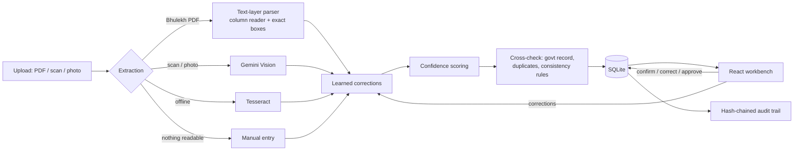

# भू-लेखा Studio — BhooLekha Studio

**AI-assisted land record digitization and validation, with a human officer in the loop.**
 — Intelligent Land Record Digitization and Validation System**
(Ministry of Rural Development, Department of Land Resources).

> This is an assistive tool. It reads and checks land records; it does **not** decide legal title or disputes.
> Every record is approved by a revenue officer before it counts.

---

## What it does

An operator uploads an old land record (Bhulekh PDF, scan or photo). The system reads it, scores how sure it is about
every field, checks it against the government record and against its own internal rules, and sends it to a
verifier, who corrects, resolves and approves it. Every action is logged in a tamper-evident audit trail, and
officer corrections teach the system to read better next time.

| SIH26018 asks for | Where it is |
|---|---|
| Multilingual extraction from scans, handwriting, PDFs | Bhulekh PDF text layer → Gemini Vision (Hindi, Telugu, …) → Tesseract → manual entry. Nothing is ever invented: unreadable fields are left blank and flagged. |
| Field classification + confidence scoring, uncertain fields | Per-field confidence with reasons (source, format checks, area arithmetic, model uncertainty); high / medium / low tiers |
| Validation: business rules, cross-database checks, duplicates | **Govt Check** tab: field-by-field comparison with the government record + **14 automated consistency rules**; duplicate-file / duplicate-khata detection |
| Human verification workflow | Side-by-side scan and fields, click a field to see it on the page, confirm / correct / add missing holders, resolve discrepancies with a note, approve |
| AI that improves over time | Officer corrections are logged; repeated misreadings are corrected automatically on new uploads (still sent for review); often-wrong fields get lower confidence; corrections are fed to the extraction prompt; accuracy-over-time chart |
| LRMS / DILRMP / GIS integration | Govt-record registry behind one module (`server/govt_registry.py`); Bhu-Naksha-style village map with plot details |
| Secure repository, audit trail, RBAC | Login with **operator / verifier / admin** roles (enforced on the server); SHA-256 **hash-chained** audit trail with integrity check |
| Dashboard | Documents processed, accuracy, validation status, pending queue, error stats by type, state/district progress, audit-chain status, learning panel |
| APIs | FastAPI, OpenAPI docs at `http://127.0.0.1:8001/docs` |

**Extra:** a public **citizen page** (`/citizen`) where a landholder uploads their own Bhulekh PDF and gets it explained in
simple Hindi/English. No login, nothing stored.

---

## Screens

- **Verification Studio:** scan on the left (with exact boxes on each extracted word), fields with confidence on the right
- **Govt Check:** consistency rules (pass / fail / warn with reasons) + comparison with the government record (match / mismatch / missing on either side)
- **History:** the khata across fasli years: who was added or removed by which mutation, and flags such as "court order removes X, but X is still listed"
- **भू-नक्शा (GIS):** Bhu-Naksha-style village sheet: khasra numbers, cart tracks, drain, legend; click a plot for its holders, area, mortgage, mutations and digitization status
- **Discrepancies, Audit Trail, Dashboard, Citizen Explainer, voice assistant** (answers only from the record)

---

## Architecture



**Frontend:** React 19 + TypeScript + Vite + Tailwind (`src/`)
**Backend:** FastAPI + SQLAlchemy + SQLite, OpenCV, pypdfium2, Gemini Vision (`server/`)

| Backend module | Job |
|---|---|
| `extractor.py`, `up_bhulekh_parser.py`, `bhulekh_columns.py`, `pdf_boxes.py` | Read the document; holders by column position; exact field boxes from the PDF |
| `validation_engine.py` | Confidence scoring, duplicate and govt cross-check at upload |
| `consistency.py` | 14 named consistency rules |
| `govt_registry.py` | Govt record lookup, comparison, history, map data (swap this for a real LRMS API) |
| `learning.py` | Correction log, learned rules, calibration, accuracy series |
| `auth.py`, `audit_chain.py` | Roles and login; hash-chained audit entries |
| `citizen.py` | Public explain endpoint (nothing stored) |

---

## Data: what is real and what is simulated

There is no public government land-records API, so the "government side" is a dataset in `server/govt_data/`,
built by `build_dataset.py`:

- **Simulated:** older history versions, neighbouring khatas and holders, all plot shapes on the map, village positions (approximate, near the tehsil HQ)
- **Real:** Census 2011 village codes; the *structure* of khata 00287 follows a real Bhulekh khatauni
- **Anonymised in this repository:** names, case numbers and amounts of that khata are fictional here. The real transcription is kept only on the team's machine (`*.local.json`, gitignored).

Replacing `govt_registry.load()` / `find()` with calls to a state LRMS API is the only change needed to run on real data.

---

## Run it

Needs **Python 3.11+** and **Node 20+**.

```bash
# backend
cd server
pip install -r requirements.txt
cp .env.example .env            # add a Gemini key (optional for Bhulekh PDFs)
python -m uvicorn main:app --port 8001

# frontend (second terminal, project root)
npm install
npm run dev                     # http://localhost:5173
```

**Demo logins** (password `demo@123`, change with `DEMO_PASSWORD` in `server/.env`):

| User | Role | Can |
|---|---|---|
| `operator` | Data entry operator | upload scans, correct fields, add missed holders/plots |
| `verifier` | Naib Tehsildar | correct, resolve discrepancies, approve and seal (cannot upload) |
| `admin` | District admin | everything |

Citizen page: `http://localhost:5173/citizen`

**Useful commands** (in `server/`):

```bash
python reset_demo_data.py --yes      # clean demo database (sample records, demo users, fresh audit chain)
python smoke_test_validation.py      # end-to-end checks on a copy of the database
python govt_data/build_dataset.py    # rebuild the simulated govt dataset + map
```

---

## Privacy and safety

- Uploaded scans and the database are never committed (`.gitignore`); real records stay on the machine that processes them
- Roles are enforced by the API, not just hidden in the UI; the person who uploads cannot approve
- The audit trail is hash-chained: editing or deleting any past entry is detected (`/api/audit/verify`, dashboard)
- The citizen page stores nothing and is rate-limited
- The assistant and explainer answer only from the record; when something is not stated (a share, transfer rights) they say so

## Known limits / next steps

- Government data is simulated or anonymised (no public API); map plot shapes are synthetic
- Gemini does not return word positions, so photos read by Gemini have no field boxes (PDFs and Tesseract do)
- Next: real LRMS / Bhu-Naksha integration through official access, map digitization from scanned village maps, batch upload
